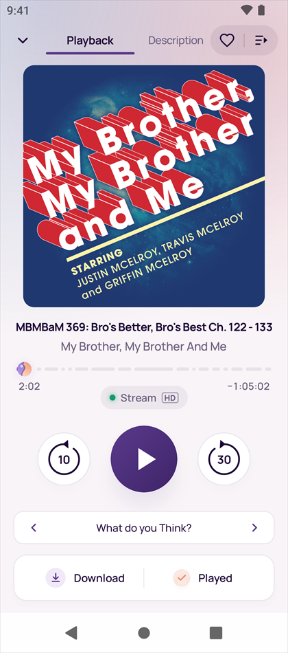
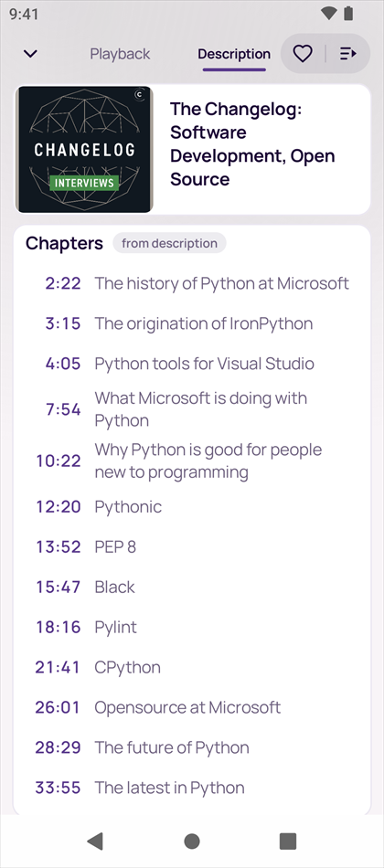
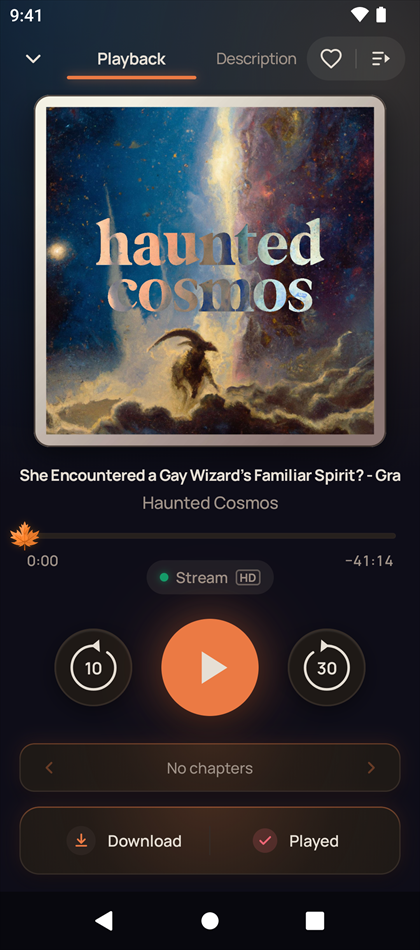
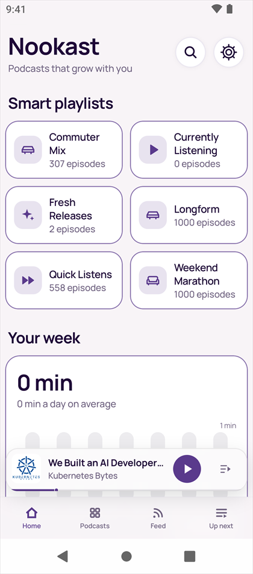
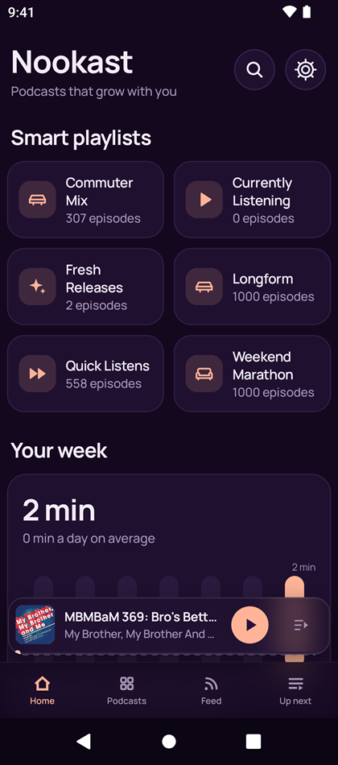
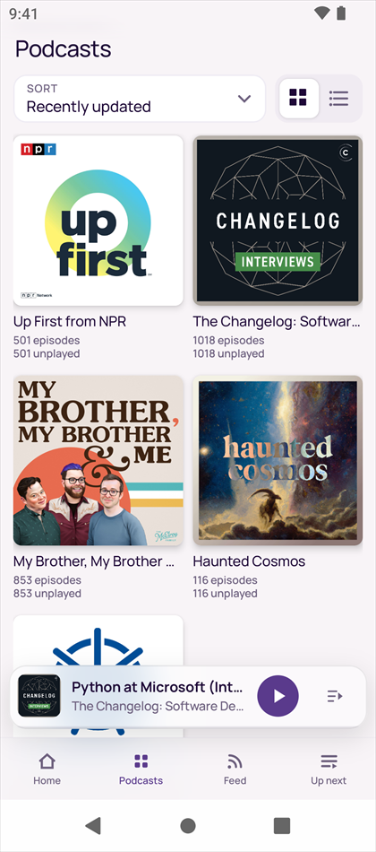
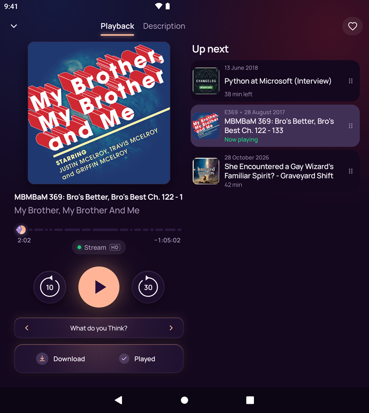

# Nookast

A native Android client for a self-hosted [PinePods](https://github.com/madeofpendletonwool/PinePods)
podcast server. Its main goal is predictable sync of playback progress and the queue across
any number of devices. Nookast is an independent project, not affiliated with PinePods.

[Русская версия ниже](#русский)

<p>
  
  
  
</p>
<p>
  
  
  
</p>
<p>
  
</p>

## Features

**Sync you can rely on**

- Playback progress, played state, favourites and the Up next queue sync with your PinePods
  server, its web app and any number of your devices.
- Every change is kept on the phone until the server confirms it: nothing is lost offline,
  when Android unloads the app or after a restart, and an older answer from the server never
  overwrites a newer change.
- Pick up where another device stopped: «Continued from 12:34 — from another device».
- Account settings stored on the server — default speed, early «played», time zone of the
  statistics — can be changed in the app.

**Playback**

- Background playback with the notification, lock screen and Bluetooth controls; back and
  forward skips set separately, from 5 to 55 seconds.
- Chapters from the feed or the file, or recognised from the timestamps in the description;
  the cover changes with the chapter, and a tap on a chapter jumps to it.
- The best source every time: a downloaded file, the copy on your server, the podcast's own
  host, or streaming through the server. When the host cannot be reached from the phone,
  «Download to server and play» continues from the same second.
- Audio processing: overall gain with a safe limit, bass and speech clarity.
- An episode picked in Up next while another plays opens as a preview, without stopping what
  plays.

**Your podcasts**

- Home: the server's smart playlists and «Your week» with listening time and the podcast of
  the week.
- Feed of the newest episodes; a Podcasts grid that marks shows gone quiet, abandoned or with
  a broken feed, with the server's reason.
- Up next: drag to reorder, swipe actions you choose (download or delete, remove, mark
  played); when nothing plays, an Up next shelf takes the mini player's place.
- Search through your server (Podcast Index) with Apple Podcasts as a fallback, or paste an
  RSS link; shows with the same name are told apart by their feed host. A podcast's RSS
  address can be changed in place.
- Downloads for offline listening and a stream buffer of 8 to 128 MB.

**Colour and immersion**

- Five palettes — Signature, Lavender, Autumn, Winter and Mint — each light and dark, with
  timeline thumbs of their own: a maple leaf in Autumn, a snowflake in Winter, a leaf in Mint.
- Colour follows the cover: Now Playing, episode pages and podcast pages glow in its tones
  under soft progressive glass headers.
- Skies of the morning, the white nights and the evening by your own location, only with your
  permission and kept on the phone; a New Year mood with snow.
- Phones, foldables and tablets: on wide screens Now Playing shows Up next beside it and the
  library keeps two panes; interface profiles for regular and large type.

**In the car**

- Android head units: a media library for the head unit (Continue, Up next, Downloads) with
  covers, and Play on the steering wheel resumes the episode even after Android unloaded the
  app. On a JAECOO J7, a short press of Previous or Next seeks and a long press changes the
  episode.
- A diagnostics journal of the commands from the wheel, the head unit and headsets, ready to
  share when something misbehaves.

**Privacy and updates**

- No analytics, ads or crash-reporting libraries (see [Network access](#network-access)).
- HTTPS by default; sign-in with a verification code when the server asks for one.
- Updates over the air from this repository, checked by SHA-256 and the signing certificate.
- Russian and English.

## Install

1. Download `nookast-<version>.apk` from [Releases](../../releases) and open it. Android 8.0
   or newer is required.
2. Sign in with the address of your PinePods server, your login and password.

### Updates

Nookast updates itself from the latest release here. Once a day it looks for a new version,
downloads it over Wi-Fi and installs it when the screen is off, nothing is playing or was
paused in the last half hour, no car is connected and no episode is downloading. In Settings →
About → Updates it can only tell you instead, or not look at all; Check now looks at once.

Android asks once to allow Nookast to install apps, and may ask you to confirm the first
update. After that, on Android 12 and newer, updates install without a prompt. Where Android
would ask (Android 11 and older, or when Nookast was first installed by another app), nothing
is installed in the background: the app offers «Update X is ready — Install / Later» when you
open it.

A new version is installed only when its SHA-256 and its signing certificate match. A release
becomes latest only after its APK has started on an emulator in the release workflow. The file
names `nookast-<version>.apk` and `nookast-<version>.apk.sha256` never change, so
[Obtainium](https://github.com/ImranR98/Obtainium) can track this repository too.

### Checking the APK

Every release lists the SHA-256 of its APK. Every APK is signed by the same certificate,
which `apksigner verify --print-certs nookast-<version>.apk` shows:

```
SHA-256 digest: 837fd9d7c432b1b0e58e954cf6835689f4fcac15849c76289fea723a66c6c5ad
```

Builds before 1.1.5 were signed by another certificate and cannot update to these releases:
uninstall such a build first. Your queue, subscriptions and progress come back from the server
after you sign in.

## Network access

Nookast talks to:

- your PinePods server;
- the RSS feeds, artwork and media hosts of your podcasts;
- `itunes.apple.com`, for podcast search when the server search is unavailable;
- `api.github.com` and GitHub's download hosts, to check for and download Nookast updates
  from this repository;
- `connectivitycheck.gstatic.com`, only when you run the extended playback diagnostics.

There are no analytics, ads or crash-reporting libraries.

## Source

This repository is a snapshot mirror: each release is a single commit, the exact source its
APK is built from. Development happens in a private repository, so pull requests cannot be
merged here, but issues and reviews are welcome. Please report security problems privately
through **Security → Report a vulnerability** ([SECURITY.md](SECURITY.md)).

The APK of every release is built and signed by
[`.github/workflows/release.yml`](.github/workflows/release.yml) from the tagged commit, and
the build log is public.

To build it yourself you need JDK 17 and the Android SDK (platform 37, build-tools 36.0.0):

```
./gradlew assembleDebug
```

The repository holds the app source and what its build needs. Design documents stay in the
private repository, so references such as `docs/SYNC.md §5` in the code comments point
there.

## License

[PolyForm Noncommercial 1.0.0](LICENSE.md). You may read, build, change and share the code
for any noncommercial purpose, including personal use. Commercial use needs a separate
permission from the author.

---

## Русский

Нативный Android-клиент для собственного сервера подкастов
[PinePods](https://github.com/madeofpendletonwool/PinePods). Главная задача — предсказуемая
синхронизация прогресса и очереди между любым числом устройств. Это независимый проект, он не
связан с авторами PinePods.

**Возможности.**

- **Синхронизация.** Прогресс, отметки «прослушано», избранное и очередь «Следующие» сходятся с
  сервером PinePods, его веб-приложением и любым числом ваших устройств. Каждое изменение
  хранится на телефоне, пока сервер его не подтвердит: оно не теряется без сети, при выгрузке
  приложения и после перезагрузки, а старый ответ сервера не перезаписывает новое изменение.
  «Продолжено с 12:34 — с другого устройства». Настройки аккаунта на сервере (скорость по
  умолчанию, ранняя отметка «прослушано», часовой пояс статистики) меняются в приложении.
- **Воспроизведение.** Фоновое воспроизведение с уведомлением, экраном блокировки и кнопками
  Bluetooth; перемотка назад и вперёд — отдельно, от 5 до 55 секунд. Главы из ленты или файла
  либо распознанные по таймкодам описания; обложка меняется вместе с главой, нажатие на главу
  переходит к ней. Лучший источник каждый раз: файл на телефоне, копия на сервере, хост подкаста
  или поток через сервер; если хост недоступен с телефона, «Скачать на сервер и слушать»
  продолжает с той же секунды. Обработка звука: общее усиление с безопасным пределом, бас и
  разборчивость речи. Выпуск, выбранный в «Следующих» во время воспроизведения, открывается
  предпросмотром и не останавливает играющее.
- **Подкасты.** Главная: умные плейлисты сервера и «Ваша неделя» со временем прослушивания и
  подкастом недели. Лента новых выпусков; сетка «Подкасты» с пометками у затихших, заброшенных и
  потерявших ленту шоу и причиной от сервера. «Следующие»: перетаскивание и свайпы на выбор
  (скачать или удалить, убрать, отметить прослушанным); когда ничего не играет, на месте
  мини-плеера полка «Следующие». Поиск через сервер (Podcast Index), запасной — каталог Apple
  Podcasts, или ссылка на RSS; шоу с одинаковым названием различаются по хосту ленты. Адрес RSS
  подкаста можно сменить на месте. Загрузки для прослушивания без сети и буфер потока от 8 до
  128 МБ.
- **Цвет и погружение.** Пять расцветок — «Фирменная», «Лаванда», «Осень», «Зима» и «Мята», у
  каждой светлый и тёмный вариант и свои бегунки шкалы: кленовый лист у «Осени», снежинка у
  «Зимы», листок у «Мяты». Цвет
  идёт от обложки: «Сейчас играет», страницы выпусков и подкастов светятся её оттенками под
  мягким прогрессивным стеклом шапок. Небо утра, белых ночей и вечера по месту, где вы
  находитесь, — только с вашего разрешения и только на телефоне; новогоднее настроение со снегом.
  Телефоны, складные и планшеты: на широком экране рядом с «Сейчас играет» очередь, а
  библиотека — в две панели; профили интерфейса для обычного и крупного текста.
- **В машине.** Магнитолы на Android: медиатека для магнитолы («Продолжить», «Следующие»,
  «Загрузки») с обложками, Play на руле возобновляет выпуск, даже если Android выгрузил
  приложение. На JAECOO J7 короткое нажатие «назад» или «вперёд» перематывает, долгое меняет
  выпуск. Журнал команд руля, магнитолы и гарнитур — чтобы отправить его, если что-то
  работает не так.
- **Приватность и обновления.** Ни аналитики, ни рекламы, ни сбора отчётов о сбоях. HTTPS по
  умолчанию, вход с кодом подтверждения, если его требует сервер. Обновления по воздуху из
  этого репозитория с проверкой SHA-256 и сертификата подписи. Русский и английский.

**Установка.** Скачайте `nookast-<версия>.apk` в [Releases](../../releases) (нужен Android 8.0
или новее), откройте его и войдите: адрес сервера PinePods, логин и пароль.

**Обновления.** Приложение обновляется само из последнего выпуска этого репозитория. Раз в сутки
оно ищет новую версию, скачивает её по Wi-Fi и ставит при выключенном экране, когда ничего не
играет и не было паузы последние полчаса, машина не подключена и не скачивается выпуск. В
Настройки → О приложении → Обновления можно выбрать «Только сообщать» или отключить поиск;
«Проверить сейчас» проверяет сразу. Android один раз попросит разрешить Нукасту установку
приложений и, возможно, подтвердить первое обновление. Дальше на Android 12 и новее обновления
ставятся без вопросов. Где Android спросил бы (Android 11 и старше или если Нукаст впервые
поставило другое приложение), в фоне ничего не ставится: при открытии приложение предложит
«Обновление X готово — Установить / Позже». Новая версия ставится,
только если совпали её SHA-256 и сертификат подписи. Последним выпуск становится только после
того, как его APK запустился на эмуляторе в workflow выпуска. Имена файлов
`nookast-<версия>.apk` и `nookast-<версия>.apk.sha256` не меняются, поэтому этот репозиторий
может отслеживать и [Obtainium](https://github.com/ImranR98/Obtainium).

**Проверка APK.** В каждом выпуске указан SHA-256 его APK. Все APK подписаны одним сертификатом,
его показывает `apksigner verify --print-certs nookast-<версия>.apk`: SHA-256
`837fd9d7c432b1b0e58e954cf6835689f4fcac15849c76289fea723a66c6c5ad`. Сборки до 1.1.5 подписаны
другим сертификатом и на эти выпуски не обновляются: такую сборку сначала удалите. Очередь,
подписки и прогресс вернутся с сервера после входа.

**Сеть.** Приложение обращается к вашему серверу PinePods, к RSS-лентам и медиахостам ваших
подкастов, к `itunes.apple.com` для поиска, если поиск сервера недоступен, к `api.github.com`
и хостам загрузки GitHub, чтобы проверять и скачивать обновления Nookast из этого репозитория, и к
`connectivitycheck.gstatic.com`, только когда вы запускаете расширенную диагностику
воспроизведения. Аналитики,
рекламы и сбора отчётов о сбоях нет.

**Код.** Этот репозиторий — зеркало выпусков: каждый выпуск — один коммит с тем кодом, из
которого собран его APK. Разработка идёт в приватном репозитории, поэтому pull request здесь не
принимаются. Issues и ревью приветствуются. Об уязвимостях сообщайте закрыто: **Security →
Report a vulnerability**. APK собирает и подписывает
[`.github/workflows/release.yml`](.github/workflows/release.yml) из коммита с тегом, журнал
сборки открыт. Здесь только код приложения и то, что нужно для его сборки. Проектные документы
остаются в приватном репозитории, на них и ссылаются комментарии в коде, например
`docs/SYNC.md §5`.

**Лицензия.** [PolyForm Noncommercial 1.0.0](LICENSE.md): читать, собирать, менять и
распространять код можно для любых некоммерческих целей, в том числе для личного
использования. Коммерческое использование — только с отдельного разрешения автора.
