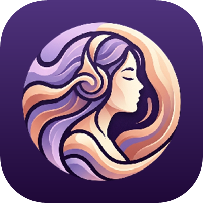
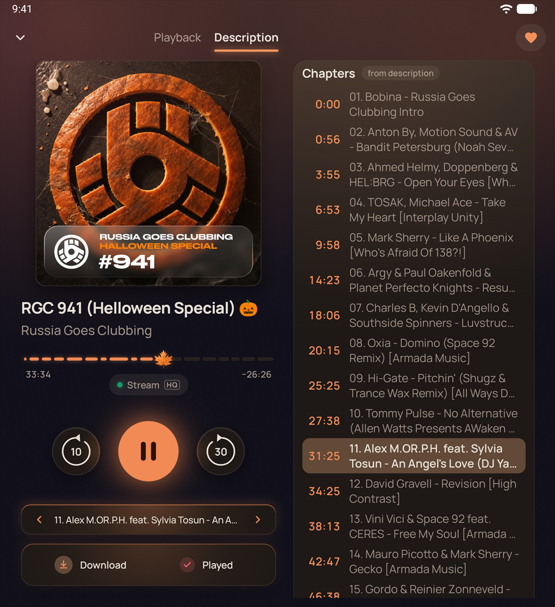
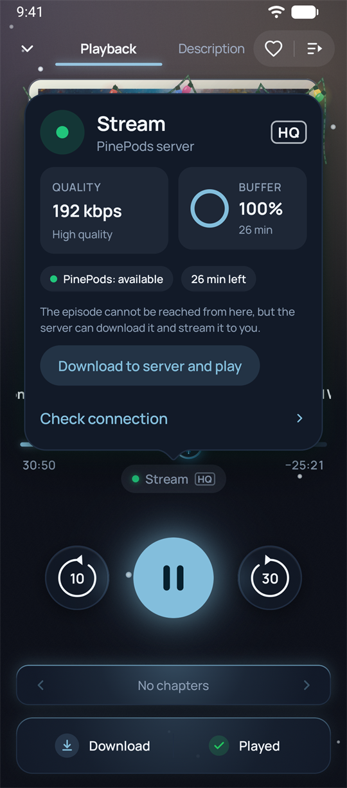
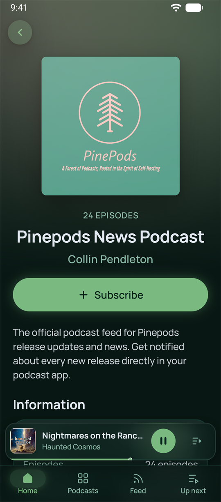
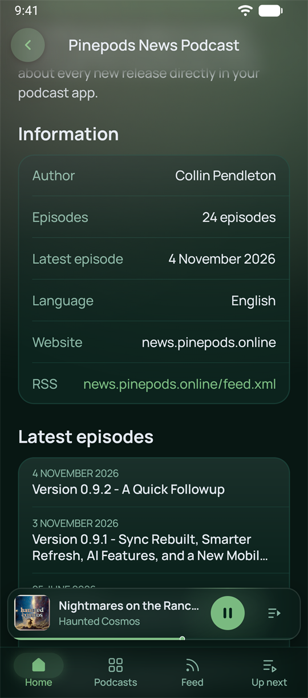
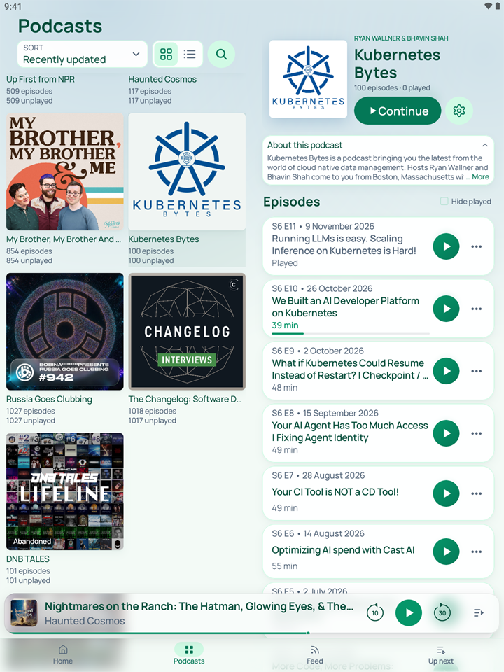
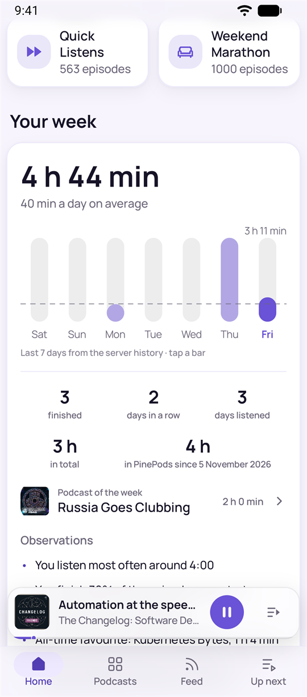
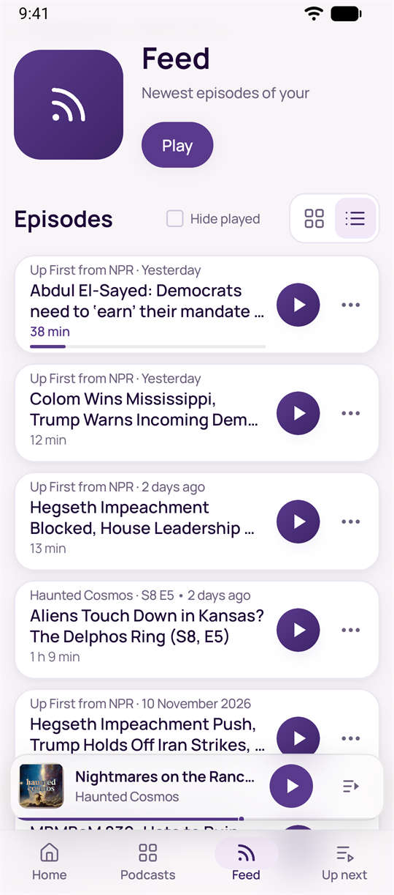

<p align="center">
  
</p>

<h1 align="center">Nookast</h1>

<p align="center">
  <b>The podcast player your own PinePods server deserves.</b><br>
  Every episode plays. Every second is remembered. On every device. 🎧
</p>

<p align="center">
  <a href="../../releases/latest"></a>
  <a href="../../releases"></a>
  <a href="../../actions/workflows/release.yml"></a>
  <a href="../../actions/workflows/codeql.yml"></a>
  <a href="https://scorecard.dev/viewer/?uri=github.com/e1173-te4/nookast"></a>
  <br>
  
  
  <a href="https://github.com/madeofpendletonwool/PinePods"></a>
  <a href="LICENSE.md"></a>
  
</p>

<p align="center">
  <a href="../../releases/latest"><b>Download the APK</b></a> ·
  <a href="https://apps.obtainium.imranr.dev/redirect?r=obtainium://add/https://github.com/e1173-te4/nookast">Add to Obtainium</a> ·
  <a href="https://e1173-te4.github.io/nookast/">Website</a> ·
  <a href="#русский">По-русски</a>
</p>

<p align="center">
  
</p>
<p align="center"><sub><b>Chapters out of thin air ✨</b> Timestamps in a show's description become real chapters: tap one
to jump, watch the current one light up. Chapters and artwork built into the episode work too. The
player takes its colours from the cover, and on wide screens the description sits right beside it.<br>
<i>Таймкоды из описания сами превращаются в главы. Плеер окрашивается в цвета обложки, а на широком
экране описание открыто рядом с ним 🍂</i></sub></p>

<table>
  <tr>
    <td width="33%" valign="top">
      
      <sub><b>Always plays.</b> The source pill shows where the sound comes from and how good the link
      is. The podcast's host can't be reached from this phone, so your server streams it, or
      downloads it and carries on from the same second. Snow for the holidays ❄️<br>
      <i>Нажали на пилюлю — и видно, откуда идёт звук и как со связью. Здесь подкаст с телефона
      недоступен, поэтому выпуск играет через ваш сервер. А за окном идёт снег.</i></sub>
    </td>
    <td width="33%" valign="top">
      
      <sub><b>Meet a show before you follow it.</b> Search your server's Podcast Index, with Apple
      Podcasts as a fallback, and open any result as a full card in its own colours.<br>
      <i>Подкаст можно рассмотреть до подписки: обложка, описание и последние выпуски 👀</i></sub>
    </td>
    <td width="33%" valign="top">
      
      <sub><b>Every detail, one tap away.</b> Author, latest episode, language, website and the RSS
      address, copied with a tap. A feed moved? Change its address in place, progress stays.<br>
      <i>Автор, сайт, язык и адрес RSS. Адрес копируется нажатием, а если лента переехала, его
      можно поменять прямо в приложении.</i></sub>
    </td>
  </tr>
</table>

<p align="center">
  
</p>
<p align="center"><sub><b>Dead shows stand out 🪦</b> «Quiet for 6 months», «Quiet for a year», «Abandoned» or «Feed
unavailable», right on the cover and with the server's reason. Large screens get two panes.<br>
<i>Заброшенные подкасты видно по пометке на обложке. На большом экране список и выбранный подкаст
открыты рядом.</i></sub></p>

<table>
  <tr>
    <td width="50%" valign="top">
      
      <sub><b>Your week 📊</b> Listening time, days in a row and the podcast of the week from your
      server's history, under the smart playlists.<br>
      <i>Сколько вы слушали за неделю, сколько дней подряд и какой подкаст слушали больше всего.</i></sub>
    </td>
    <td width="50%" valign="top">
      
      <sub><b>Feed.</b> The newest episodes of all your shows in one list, one tap from playing.<br>
      <i>Новые выпуски всех подписок одним списком 🎧</i></sub>
    </td>
  </tr>
</table>

## Why Nookast

- 🛟 **It always plays.** Can't reach the podcast's host from your phone? Nookast streams through your
  server, or has the server fetch the episode and carries on from the very same second.
- 📡 **You see the connection.** The source pill is the small capsule under the timeline in Now
  Playing. It tells where the sound comes from — the phone, the copy on your server, the podcast's
  host or a stream through the server — and how good the link is; a green dot means all is well.
  Tap it for quality, buffer, a connection check and, when the host is out of reach, a way to play
  through the server.
- 🧭 **It never loses your place.** Every tap is kept on the phone until the server confirms it.
  No signal, a killed app, a reboot — nothing is lost, and a stale answer from the server never
  overwrites what you just did. Pick up on another device to the second.
- **Chapters everywhere.** From the feed, from the file with their own pictures, or recognised from
  plain timestamps in the description.
- **Dead shows stand out.** Covers say «Quiet for 6 months», «Quiet for a year», «Abandoned» or
  «Feed unavailable» — with the server's reason. A feed moved? Change its RSS address in place;
  your progress stays.
- 🎨 **Made to be looked at.** Five palettes, each light and dark, colours from the cover, skies that
  follow the real sun where you are, and a New Year mood with snow.
- **Any screen.** Phones, foldables, tablets and large displays, with two panes where there is room.
- 🔒 **Private.** No analytics, ads or trackers. Updates itself from this repository, checked by
  SHA-256 and signature.

## Install

1. Download `nookast-<version>.apk` from [Releases](../../releases/latest) and open it.
2. Sign in with your PinePods server address, login and password.

Nookast then updates itself: once a day it installs a new version over Wi-Fi while the phone is
idle and nothing plays (Settings → About → Updates can make it only tell you, or stop looking).
Android asks once to allow Nookast to install apps and may ask you to confirm the first update.
Where Android would ask every time (Android 11 and older), the app offers «Update X is ready —
Install / Later» when you open it. Prefer [Obtainium](https://github.com/ImranR98/Obtainium)? The
file names never change, so it tracks this repository as is.

<details>
<summary>Check the APK yourself</summary>

Every release lists the SHA-256 of its APK, and every APK is signed by the same certificate:

```
SHA-256 digest: 837fd9d7c432b1b0e58e954cf6835689f4fcac15849c76289fea723a66c6c5ad
```

`apksigner verify --print-certs nookast-<version>.apk` shows it. A release becomes latest only after
its APK has started on an emulator in the public release workflow. Builds before 1.1.5 used another
certificate: uninstall them first, everything comes back from the server.
</details>

<details>
<summary>Network access</summary>

Nookast talks only to your PinePods server; the feeds, artwork and media hosts of your podcasts;
`itunes.apple.com` when the server search is unavailable; `api.github.com` and GitHub's download
hosts for its own updates; `connectivitycheck.gstatic.com` and `ya.ru` only when you run the
connection check in the playback diagnostics.
</details>

## Source and license

This repository is a snapshot mirror: each release is one commit with the exact source its APK
is built from by [`.github/workflows/release.yml`](.github/workflows/release.yml), with a public
build log. Development happens privately, so pull requests can't be merged here, but issues and
reviews are welcome — see [CONTRIBUTING.md](CONTRIBUTING.md) and [SUPPORT.md](SUPPORT.md); report
security problems privately ([SECURITY.md](SECURITY.md)). AI coding agents start with
[AGENTS.md](AGENTS.md). Build it yourself with JDK 17 and the Android SDK 37:
`./gradlew assembleDebug`. Code comments that cite `docs/…` refer to design documents kept in the
private repository.

[PolyForm Noncommercial 1.0.0](LICENSE.md): read, build, change and share the code for any
noncommercial purpose. Commercial use needs the author's permission. Nookast is an independent
project, not affiliated with [PinePods](https://github.com/madeofpendletonwool/PinePods).

## Built with

[Kotlin](https://kotlinlang.org) and coroutines ·
[Jetpack Compose](https://developer.android.com/compose) with Material 3 ·
[Media3 ExoPlayer](https://developer.android.com/media/media3) ·
[Room](https://developer.android.com/training/data-storage/room) ·
[WorkManager](https://developer.android.com/develop/background-work/background-tasks/persistent) ·
[OkHttp](https://square.github.io/okhttp/) · [Coil](https://coil-kt.github.io/coil/) ·
[Haze](https://github.com/chrisbanes/haze) · the [Manrope](https://github.com/googlefonts/manrope)
typeface. Thank you to their authors, and to [PinePods](https://github.com/madeofpendletonwool/PinePods)
for the server it all talks to. Every library and its license is listed in the app under
**Settings → About → Licenses**.

## 100% vibe-coded 🤖

Every line of Nookast was written by AI; a human set the goals, tried the builds and said yes or
no. Please treat the code accordingly.

---

## Русский

**Nookast (по-русски Нукаст) — плеер подкастов для вашего сервера PinePods.** Он помнит, где вы
остановились, и на любом устройстве продолжает с того же места. 🎧

Что в нём хорошего:

- 🛟 **Выпуск сыграет, даже если подкаст недоступен напрямую.** Тогда звук пойдёт через ваш
  сервер. А если и так не выйдет, сервер скачает выпуск к себе, и приложение продолжит с той же
  секунды.
- 📡 **Видно, откуда идёт звук.** Под шкалой времени в плеере есть небольшая плашка — пилюля. По
  ней понятно, что сейчас играет: файл на телефоне, копия на сервере, сам подкаст или поток через
  сервер, и как дела со связью. Зелёная точка значит, что всё в порядке. Если нажать на пилюлю,
  откроются подробности: качество, запас буфера, проверка связи, а когда подкаст с телефона
  недоступен — кнопка, чтобы слушать через сервер.
- 🧭 **Ничего не теряется.** Всё, что вы делаете в приложении, сначала сохраняется на телефоне и
  уходит на сервер, когда тот доступен. Пропала сеть, телефон перезагрузился, приложение закрылось
  — прогресс на месте. И старые данные с сервера не перепишут то, что вы только что сделали.
- **Главы.** Нукаст берёт главы из ленты или из самого файла, вместе с картинками. Если глав нет,
  но в описании выпуска есть таймкоды, он сделает главы из них.
- **Сразу видно, какие подкасты заброшены.** На обложке появляется пометка «Полгода тишины», «Год
  тишины», «Заброшен» или «Лента недоступна», а сервер объясняет причину. Если подкаст переехал на
  новый адрес, его можно поменять прямо в приложении, прогресс сохранится.
- 🎨 **Красиво.** Пять цветовых тем, у каждой светлый и тёмный вариант. Плеер подстраивается под
  цвета обложки, а ночью небо в приложении меняется вслед за настоящим солнцем там, где вы
  находитесь. На Новый год — снег и гирлянда.
- **Удобно на любом экране.** Телефон, складной смартфон, планшет: на широком экране всё
  раскладывается в две колонки.
- 🔒 **Без слежки.** Никакой аналитики, рекламы и трекеров. Обновления приходят прямо из этого
  репозитория, и приложение проверяет их подпись.

**Как установить.** Скачайте `nookast-<версия>.apk` на странице [Releases](../../releases/latest),
откройте файл и войдите: адрес вашего сервера PinePods, логин и пароль. Потом Нукаст обновляется
сам. Раз в сутки, когда телефон лежит без дела и ничего не играет, он ставит новую версию по Wi-Fi.
Если хотите решать сами, в «Настройки → О приложении → Обновления» можно оставить только
уведомления или выключить проверку совсем. Android один раз спросит разрешение на установку
приложений и, возможно, попросит подтвердить первое обновление. На Android 11 и старше приложение
при запуске само предложит: «Обновление X готово — Установить / Позже». Пользуетесь
[Obtainium](https://github.com/ImranR98/Obtainium)? Он тоже умеет следить за этим репозиторием.

**Как проверить APK.** Все выпуски подписаны одним и тем же сертификатом, его SHA-256:
`837fd9d7c432b1b0e58e954cf6835689f4fcac15849c76289fea723a66c6c5ad`. Новая версия становится
последней, только когда её APK успешно запустился на эмуляторе. Сборки до 1.1.5 подписаны другим
сертификатом. Их нужно сначала удалить, а подписки и прогресс потом вернутся с сервера.

**Куда приложение выходит в сеть.** Только на ваш сервер PinePods и к лентам, обложкам и файлам
ваших подкастов. Ещё на `itunes.apple.com`, если поиск на сервере не работает, и на `api.github.com`
с хостами загрузки GitHub, чтобы проверять обновления. На `connectivitycheck.gstatic.com` и `ya.ru`
оно обращается, только когда вы сами запускаете проверку связи в диагностике.

**Код и лицензия.** Здесь лежит ровно тот код, из которого собран каждый выпуск: один выпуск — один
коммит, а собирает его открытый workflow. Pull request сюда не принимаются, а вот issues и ревью мы
очень ждём, подробнее в [CONTRIBUTING.md](CONTRIBUTING.md). Об уязвимостях пишите закрыто
([SECURITY.md](SECURITY.md)). Лицензия [PolyForm Noncommercial 1.0.0](LICENSE.md) разрешает любое
некоммерческое использование, для коммерческого нужно разрешение автора. Нукаст — независимый
проект, с авторами PinePods он не связан.

**На чём сделан.** Kotlin, Jetpack Compose и Material 3, плеер Media3 ExoPlayer, база Room,
WorkManager для фоновой синхронизации, OkHttp, Coil для обложек, Haze для эффекта матового стекла и
шрифт Manrope. Спасибо их авторам и отдельно PinePods: всё это работает с его сервером. Полный
список библиотек с лицензиями есть в приложении: «Настройки → О приложении → Лицензии».

**Сто процентов вайбкода 🤖** Весь код Нукаста написал ИИ, а человек ставил задачи, гонял сборки и
говорил «да» или «переделай». Отнеситесь к коду с пониманием.
